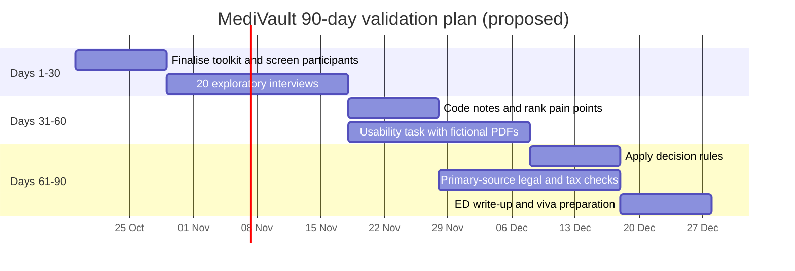
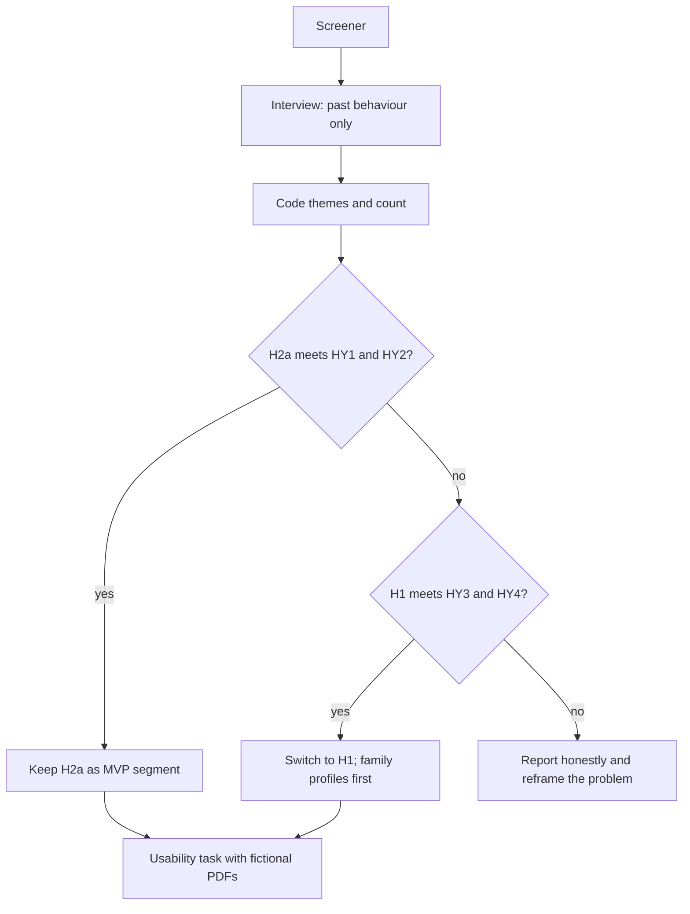
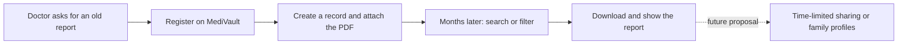

# MediVault: Entrepreneurship Development Business Plan

> **Labels:** **[REPO]** documented for `origin/main` @ `d80c1bf` (README and PR #1; this code was not run or independently tested in this work) · **[V]** official source, fetched and read · **[V-sec]** secondary source, or an official source seen only in search results · **[A]** assumption · **[P]** pending customer validation · **[PROP]** proposal
>
> **Product baseline:** GitHub `CodesbyRohit/MediVault`, `origin/main` @ `d80c1bf` (merge of PR #1, 2026-10-12).
> **Status:** This is a provisional structure for the Entrepreneurship Development (ED) mini-project by Rohit Srivastava, second-year B.E. Computer Engineering, MCT's Rajiv Gandhi Institute of Technology (RGIT), Mumbai. It is not the official RGIT template, and sections can be reordered to match one. Source IDs (S#) refer to [`06-source-register.md`](06-source-register.md). Research was accessed on 2026-10-12.

**Supporting documents:**

- [02 Competitor analysis](02-competitor-analysis.md)
- [03 Customer discovery toolkit](03-customer-discovery-toolkit.md)
- [04 Financial model](04-financial-model.md)
- [05 Legal, privacy and risk](05-legal-privacy-risk.md)
- [06 Source register](06-source-register.md)
- [07 Pitch and viva](07-pitch-and-viva.md)

---

## 1. Executive summary

MediVault is a Java/Spring Boot web application. It helps a person keep their own medical records organised, with the PDF reports attached to each record.

**What the product does today** (at `d80c1bf`) [REPO, S2, S3]:

- create, edit, delete, search and filter records;
- owner-only access to records and documents;
- a 100 MB document quota per patient;
- new PDFs encrypted at rest with a key held on the server.

**What it is not:** it is a **local student prototype for fictional data only**. It is not hosted, not end-to-end encrypted, and its database is not encrypted.

**Business thesis (provisional).** People who repeatedly receive diagnostic reports may struggle to find older ones when a doctor asks for them. A focused, ad-free, provider-independent organiser might serve them better than a phone gallery or a general cloud folder.

**What the evidence shows so far:**

- Strong, free alternatives already exist: the ABHA app, DigiLocker, Google One and iCloud [S6, S8, S13, S14].
- No secondary source establishes demand for MediVault, or willingness to pay, in any segment [P].

**Strategy:**

- **Working segment:** H2a (individuals with repeated diagnostic tests) is the *provisional working hypothesis*.
- **Tested in parallel:** H1 (Mumbai family caregivers).
- **Revenue model (hypothesis):** freemium, with a single **Family plan** as a possible paid tier. This is unvalidated.

**Finance (illustrative, see `04-financial-model.md`):**

- The prototype costs ₹0–₹1,800 in cash per semester.
- A hypothetical commercial service has a fixed cost of about ₹22,300/month, including founder time.
- It would break even at about **335** paying families (paying-only) or about **483** (including free users at an illustrative 5% conversion).
- An illustrative year one ends at **−₹83,202 cash** and **−₹3,01,422** on an economic basis.

**Next step:** 20 exploratory customer conversations and a usability task with fictional data. The decision thresholds are set in advance.

## 2. Problem statement

People's medical documents end up scattered: lab reports, prescriptions, scan reports, discharge summaries and vaccination certificates sit in paper files, phone galleries, messaging apps and separate clinic or lab portals.

**Possible consequences [A, P]:**

- A report cannot be found when a doctor asks for it.
- Tests are repeated.
- A new doctor gets an incomplete history.

**Evidence status:**

- The problem is plausible and widely described.
- How often it happens, and how severe it is, for any specific segment is **not established** [P]. No Indian survey was found that measures how people store or retrieve their medical documents.
- Context only, not demand: people aged 60+ were about 10.1% of India's population in 2021, projected to be 13.1% by 2031 [S24, V-sec].
- Some studies report low ABHA awareness [S26, S27, V-sec]. That points to an awareness gap, not demand for MediVault.

## 3. Proposed solution and current product

### 3.1 What exists at `d80c1bf` [REPO, S2, S3]

**Accounts:**
- Patient self-registration and login.
- BCrypt password hashes, CSRF protection and session protection.

**Records:**
- Create, edit and delete records, each with a title, type, date, provider and notes.
- An edit made from an outdated copy is rejected.
- Search, filters, sorting and paging, all limited to the patient's own records.

**Documents:**
- PDF attachments, up to 10 MB each, with a 100 MB quota per patient.
- Uploads are checked: extension, declared type, PDF header and end-of-file marker.
- Download and confirmed deletion.

**Access control:**
- Owner-only, as documented and covered by the author's tests. Another patient gets 404; an administrator gets 403 and cannot see medical content.

**Encryption:**
- New PDFs are encrypted at rest with Google Tink AES-256-GCM, using a **server-held keyset file**.
- Each download is checked against its stored size and SHA-256 checksum before it is sent.

**Testing:**
- The author reports 516 tests: 496 passed, 0 failed, 20 skipped [S2]. **These tests were not re-run in this work.**

### 3.2 Documented limitations [REPO, S3]

**Security:**
- Not end-to-end encrypted. The **database is not encrypted**.
- PDFs uploaded before encryption was added remain in plaintext.
- **If the keyset is lost, encrypted PDFs are permanently unreadable.**

**Deployment and access:**
- Runs on one computer only (`127.0.0.1`), with no HTTPS. It cannot be used from a phone.
- No rate limiting, password reset or email verification.

**Missing features:**
- No sharing, family profiles, export, account deletion or audit trail.
- MySQL 8.4 has not been verified.

**Usage rule:** fictional data only.

### 3.3 MVP and roadmap

| Item | Status |
|---|---|
| Personal organiser: records, PDFs, search, owner-only access | **Built** [REPO] |
| Hardening before any real data: hosting and HTTPS, rate limiting, password reset, export, account deletion, keyset backup procedure | [PROP] |
| Family or dependant profiles with delegated access (the Family plan) | [PROP], depends on H1 evidence |
| Time-limited, revocable sharing with a doctor | [PROP] |
| ABHA/ABDM integration | [PROP], only after primary-source verification and certification [S23] |

## 4. Target market

### 4.1 Segments

- **H2a (provisional working hypothesis):** individuals, roughly in Mumbai, who visited a lab or diagnostic centre for themselves two or more times in the last 12 months. They are identified by the *number of visits*, never by condition.
- **H1 (tested in parallel):** Mumbai adults who help an elderly family member keep or find their medical documents.
- **Not targeted:** hospitals, clinics, labs and insurers as customers. B2B is only a later hypothesis.

### 4.2 Segment scorecard

**How the scores work:**
- This is a provisional, equal-weighted assessment, **not a measurement**.
- Scores run from 1 to 5, where 5 favours MediVault.
- "Unknown" is not scored.

| # | Criterion | H1 caregivers | H2 personal organisers |
|---|---|---|---|
| 1 | How severe and frequent the problem is | **Unknown** [P]; only ageing-population context [S24] | **Unknown** [P] |
| 2 | Secondary evidence of *this* need | **1**: none found | **1**: none found; an ABHA awareness gap only [S26, S27] |
| 3 | Room left by alternatives (5 = weak alternatives) | **2**: Eka Care advertises family profiles in its App Store listing [S9]; ABHA and DigiLocker [S6, S8] | **1**: free ABHA, DigiLocker, Google 15 GB, iCloud 5 GB [S6, S8, S13, S14]; gallery, WhatsApp and paper [A] |
| 4 | Willingness to pay | **Unknown** [P] | **Unknown** [P]; ₹59/month Google One Lite [S13] is a price anchor, not willingness to pay |
| 5 | Ease of reaching the first users | **3** [A]: family network, but needs ethical care | **4** [A]: peers and campus; risk of a biased sample |
| 6 | Fit with today's product | **2** [REPO]: no dependant profiles | **4** [REPO]: one person per account; local only |
| 7 | Extra features and privacy risk needed (5 = little) | **1** [REPO + A]: dependant profiles, delegated access, the parent's consent | **3** [REPO + A]: hosting, HTTPS, password reset, export, keyset backup |
| 8 | Business-model viability | **3** [A]: Family plan is plausible, but a competitor already offers family profiles and sells a paid tier (Eka Pass) [S9] | **2** [A]: equivalents cost ₹0 |
| | **Subtotal of the 6 scored criteria** | **12 / 30** | **15 / 30** |

**What drives the gap:** it comes from product fit and privacy risk, not from customer evidence. If interviews show H1 at least 2 points ahead on *both* of the unknown criteria, H1 overtakes.

### 4.3 Conditional recommendation

**H2, narrowed to H2a, is the stronger *initial working hypothesis*.**

- It fits what `d80c1bf` can do.
- It needs fewer new features and carries less privacy risk.
- It is cheaper to recruit for.

Its alternatives are the strongest, and its business model is the weakest. **H1 remains the leading monetisation hypothesis.**

**This is not customer validation.** These results would reverse it (thresholds proposed in `03-customer-discovery-toolkit.md` §10):

- **H2a fails:** if 2 or fewer of 10 H2a participants report a recent retrieval problem, or most are satisfied with their current tools, drop or reframe H2a.
- **H1 passes instead:** if H1 meets both thresholds (at least 5 of 10 report a problem and at least 3 of 10 say their tool failed) while H2a does not, switch to H1 and build family profiles first.
- **Neither passes:** report that honestly and reframe the problem.

### 4.4 Market size

**Limitation.** No credible data was found on demand for a personal medical-document organiser in Mumbai. So no TAM, SAM or SOM figure is given (total, serviceable and obtainable market).

A bottom-up estimate can be built **only after** the interviews:

- Serviceable users ≈ adults in the target area × share with ≥ 2 diagnostic visits a year [P] × share reporting a retrieval problem [P]
- Paying families ≈ serviceable users × conversion [P]

Every input is either unknown or pending, so no number is shown.

## 5. Value proposition and positioning

**Value proposition [PROP]:** one structured, searchable history of your own medical reports, with each PDF attached. Only your account can open it.

**Positioning statement (draft):**

> For people in Mumbai who repeatedly receive diagnostic reports and struggle to find older ones when a doctor asks, MediVault is a personal medical-record organiser that keeps each report with its date, type and provider so it can be found quickly. Unlike a phone gallery or a general cloud folder, records sit in a structured, searchable history that only the account owner can open (as implemented and tested by the author at `d80c1bf`), with no ads and no provider lock-in.

**Product promise to *test* [PROP]:** "Find any report in under a minute." This is measured in the usability task. It is not a claim.

**Messaging rules:**

- **Use:**
  - "organised";
  - "searchable";
  - "only your account can open it, as implemented";
  - "new PDFs are encrypted at rest; not end-to-end".
- **Never use:**
  - "secure vault" or "encrypted vault";
  - "end-to-end";
  - "first", "only", "unique" or "no competitors";
  - "compliant", "certified" or "ABDM-integrated";
  - user numbers, testimonials or partners.

## 6. Competitor analysis (summary)

**Direct competitors:**

- ABHA app [S6, S7]
- DigiLocker health locker [S8; 2022, current status unverified]
- Eka Care [S9, S28]: family profiles and a paid in-app **Eka Pass** ($2.49/month on the US-dollar App Store; INR price unverified)
- Apollo 24|7 PHR [S10]

**Indirect alternatives:**

- Lab apps [S11, S12]
- Google One: 15 GB free; ₹59 for 30 GB; ₹130 for 100 GB per month [S13, V]
- iCloud+: 5 GB free; ₹75 for 50 GB per month [S14, V]
- WhatsApp, phone gallery and paper [A]

**Differentiation is thin and easy to copy.** The full comparison table, the SWOT and Porter's Five Forces are in [`02-competitor-analysis.md`](02-competitor-analysis.md).

**SWOT summary:**

| Strengths | Weaknesses |
|---|---|
| Owner-only access (as documented); structured search; new PDFs encrypted at rest; near-zero cash cost [REPO] | Local only; no HTTPS; database not encrypted; no family profiles or sharing; keyset-loss risk; solo founder; no validation [REPO] |
| **Opportunities** | **Threats** |
| ABHA awareness gaps [S26, S27]; ageing population context [S24]; Family plan hypothesis [A] | Free and funded alternatives [S6, S8, S9, S13]; DPDP obligations from 13 May 2027 [S20, verify]; trust barrier; easy to copy [A] |

**Porter's Five Forces:**

- Rivalry: high.
- Threat of substitutes: very high.
- Threat of new entrants: high for a basic organiser.
- Buyer power: high.
- Supplier power: low to moderate.

## 7. Business Model Canvas

**Tags:** **F** = current fact · **S** = proposed strategy · **H** = unvalidated hypothesis

| Block | Entries |
|---|---|
| **1. Customer segments** | H2a individuals with repeated diagnostic tests (H) · H1 caregivers as the upgrade segment (H) · Institutions are not customers (S) |
| **2. Value propositions** | Structured, searchable record history with PDFs (F) · Owner-only access; admins cannot see content (F) · New PDFs encrypted at rest; not end-to-end (F) · No ads, no provider lock-in (S) · Faster retrieval than current habits (H) |
| **3. Channels** | Campus and peer network for interviews and fictional-data demos (S) · Word of mouth (H) · No paid advertising (S) |
| **4. Customer relationships** | Self-service (F) · Direct founder support during validation (S) · Feedback after the usability task (S) |
| **5. Revenue streams** | None today (F) · Free personal tier (S) · Family plan subscription at an illustrative ₹99/month (H) · Payment fee 2% + 18% GST on the fee if a paid tier launches [S15] (F, the price) · **Excluded:** advertising, selling or monetising any health data (S) |
| **6. Key resources** | The `d80c1bf` codebase and test suite (F; test results author-reported) · Founder time, which has a real economic cost (F) · The server-held keyset, so its backup is critical (F) |
| **7. Key activities** | Customer discovery (S) · Hardening before any real data (S) · Keyset and backup operations (S) · Primary-source legal verification (S) |
| **8. Key partnerships** | **None exist** (F) · A hosting provider (S) · ABDM integration, only after verification and certification (H) |
| **9. Cost structure** | Founder time (F) · Hosting, storage, backups, monitoring, keyset management, security testing, maintenance, support, payment fees, GST (S; quantified as illustrative estimates in `04-financial-model.md`) |

**Why freemium plus one Family plan, and not storage upsells.** Storage is already sold cheaply by trusted brands, from ₹59/month [S13]. A family plan sells organisation and delegated access instead. Whether anyone will pay for that is **unvalidated**. B2B and lab partnerships remain later hypotheses.

## 8. Marketing and go-to-market strategy

| Element | Plan [PROP] |
|---|---|
| Initial segment | H2a, with H1 in parallel |
| Early-adopter hypothesis [A] | People who had several lab visits recently and keep reports in more than one place |
| Message | "Keep every report with its date, type and provider, and find it when the doctor asks." |
| Acquisition channel | Personal and campus network through the screener. No paid ads, and no claimed partners. |
| Onboarding | Register, add the first record, attach a PDF, then search. In the prototype, fictional PDFs only. |
| Feedback | Interview notes, plus the usability task with an "expected vs actual" question |
| Metrics (thresholds proposed) | Interview completion rate; share with a recent retrieval problem (≥ 5 of 10); share whose current tool failed (≥ 3 of 10); task completion (≥ 80%); time to locate a record vs their self-reported time; trust concerns counted; current paid storage counted (no threshold) |
| Retention and repeat use | **Cannot be measured** with fictional data. Deferred until hardening is done and legal review allows real use. |
| Referral hypotheses [A] | Caregivers may share with siblings; peers may share on campus |
| Partnership strategy | None exist. Any lab or clinic partnership is a later hypothesis, needing legal review first. |

### 90-day plan

The dates are a proposed plan, not commitments.

### Validation flow

### Customer journey

## 9. Operational plan

| Area | Plan |
|---|---|
| Team | One founder, Rohit Srivastava, who builds, researches and supports. There are no other team members, mentors or partners. |
| Development | Follows the repository's milestone process: approval gates, automated tests, no real data |
| Data handling (prototype) | Fictional data only. The study's contact data is minimised, stored separately and deleted at project end. |
| Keyset | Stored outside the data folder; two offline copies; a restore drill [PROP] |
| Support (if launched) | Founder handles email support. Time is costed at ₹30 per paying family per month [A]. |
| Before any real data | Hardening, an independent security test, lawyer-reviewed terms and privacy notice, primary-source legal verification [PROP] |

## 10. Financial feasibility (summary; illustrative, not a forecast)

All figures are from [`04-financial-model.md`](04-financial-model.md). Vendor prices are quoted from official pages [V]. Everything else is [A] and **provisional**.

| Item | Value |
|---|---|
| Student prototype, cash per semester | ₹0 / ₹800 / ₹1,800 (low, base, high) [A] |
| Hosting, base: $35.75 × 1.18 × ₹96 | ₹4,049.76 ≈ ₹4,050 /month [S16, S17, S30 × A] |
| Recurring cash K | ₹5,300 /month |
| Fixed cost F (K + security test accrued + founder fixed time) | ₹22,300 /month |
| Contribution per paying family: Cₚ = 99 − 2.3364 − 30 | ₹66.66 |
| Break-even, paying-only (F ÷ Cₚ) | **335** families (fully-loaded storage variant: 340) |
| Break-even including free users at an illustrative 5% conversion | **483** families, 9,660 users in total (fully-loaded: 496) |
| Year one: operating cash / month-0 spending / total cash | +₹11,798 / −₹95,000 / **−₹83,202** (lowest point −₹1,07,000 in month 5) |
| Year one, economic (with founder time ≈ 727 h) | **−₹3,01,422** |

**What the year-one scenario assumes:**
- 10 more paying families every month.
- No churn and no paid marketing.
- 5% conversion.
- Storage stays within the 250 GiB allowance.

**What the sensitivity analysis shows:** the result depends mostly on price and willingness to pay, support time, founder time and conversion. Storage and the exchange rate matter little.

**Conclusion:**
- Feasible as a low-cash prototype.
- **Commercial viability is unproven.**

## 11. Risk and privacy considerations (summary)

The full detail and the risk register are in [`05-legal-privacy-risk.md`](05-legal-privacy-risk.md).

**Main risks:**
- no real demand;
- free alternatives win;
- nobody pays;
- keyset loss;
- real data entered into the prototype;
- a future breach;
- misreading legal duties;
- trust;
- copying;
- founder time.

**Legal duties awaiting primary-source verification:**
- DPDP Rules 2025, with core duties reportedly from 13 May 2027 [S20];
- CERT-In 2022 Directions [S22];
- ABDM integration requirements [S23];
- IT Act s.43A / SPDI status.

**No claim of compliance, certification or ABDM integration is made.**

## 12. Milestones

| Milestone | Status |
|---|---|
| Product M1–M3 at `d80c1bf`: accounts, records, documents, encryption of new PDFs at rest | Done according to the author [S2]; not re-run here |
| ED Stages 1–6: audit, research, strategy, financial model, documents | Done (this package) |
| ED-V1: 20 exploratory interviews | Pending |
| ED-V2: usability task with fictional PDFs | Pending |
| ED-V3: beachhead decision using the proposed rules | Pending |
| ED-V4: primary-source legal and tax verification; RBI rate refresh | Pending |
| Hardening before any real data | Future proposal |

### Riskiest assumptions, in order

1. The retrieval problem is frequent enough that people switch from free habits.
2. People will trust a student-built service with health documents.
3. Someone will pay for a Family plan.
4. H1's extra privacy burden is manageable.
5. The operator can manage the keyset safely.

## 13. Conclusion

**What is ready.** MediVault is a well-tested local prototype (by the author's report) of a personal medical-record organiser. It has documented, honest security limits.

**What is not yet known.** The business case is **not yet validated**:

- Free government and private alternatives are strong.
- Differentiation is thin.
- No evidence yet shows that people will pay.

**The proposed path is deliberately small:**

1. Test H2a and H1 with 20 exploratory conversations and a fictional-data usability task, using decision rules set in advance.
2. Verify the legal and tax questions from primary sources.
3. Only then decide whether to build the hardening and family-profile features a real service would need.

A negative result would be a legitimate and useful ED outcome.
